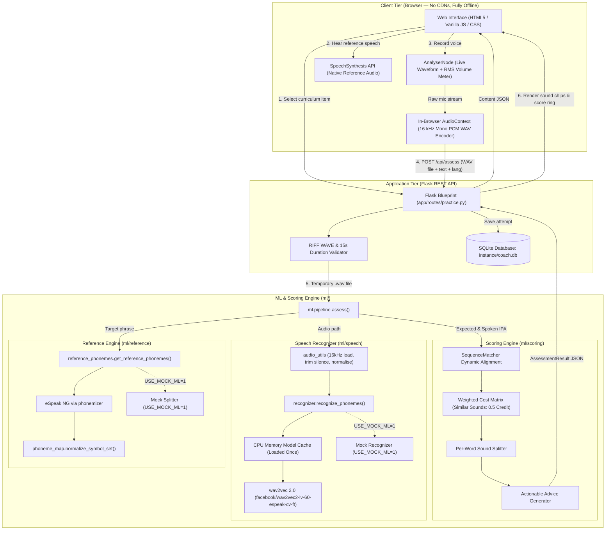
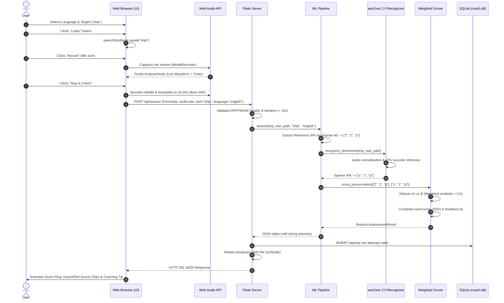

# System Architecture: Language Coach

This document details the modular software architecture, data pipelines, sequence interactions, data contracts, and design rationales for the **Language Coach** pronunciation assessment system.

---

## 1. End-to-End System Pipeline



---

## 2. Sequence Diagram: A Single Practice Attempt



---

## 3. Module Responsibilities & Folder Boundaries

| Module | Files | Responsibility | Role Owner |
|---|---|---|---|
| **API & Routing** | `app/routes/practice.py` | Validates file uploads, handles page routing (`/`, `/practice`, `/progress`), invokes ML pipeline, returns JSON. | R4 |
| **Web Presentation** | `app/templates/*`, `app/static/*` | Glassmorphic UI, theme toggle, live waveform visualizer, client WAV conversion, progress chart. | R4 |
| **Database Access** | `app/db.py` | Thread-safe SQLite attempt persistence and querying. | R4 |
| **ML Glue** | `ml/pipeline.py` | Orchestrates reference extraction, recognition, and scoring with per-stage timing metrics. | R1 |
| **Data Contracts** | `ml/contracts.py` | Immutable dataclasses defining interchange formats. | R1 |
| **Speech Preprocessing** | `ml/speech/audio_utils.py` | 16 kHz mono loading, silence trimming (top-db=30), peak normalisation. | R2 |
| **Acoustic Recognizer** | `ml/speech/recognizer.py` | Pretrained wav2vec 2.0 acoustic phone decoder with singleton CPU model cache. | R2 |
| **Reference Phonemes** | `ml/reference/reference_phonemes.py` | Cross-lingual IPA generation via eSpeak NG / phonemizer with LRU cache. | R3 |
| **Phoneme Normalizer** | `ml/reference/phoneme_map.py` | Symbol set harmonization (vowel lengths, atomic diphthongs, stress stripping). | R3 |
| **Weighted Scorer** | `ml/scoring/scorer.py` | Levenshtein alignment with similarity cost matrix, multi-word scoring, and human feedback. | R3 |
| **Curriculum Content** | `data/content/*.json` | Curated beginner, intermediate, and advanced phrases across 4 languages. | R5 |

---

## 4. API Endpoints

| Endpoint | Method | Input Parameters | Output Format | Description |
|---|---|---|---|---|
| `/` | `GET` | None | HTML | Landing page with hero section and language cards. |
| `/practice` | `GET` | Optional query: `?lang=english` | HTML | Interactive practice studio. |
| `/progress` | `GET` | None | HTML | Learner dashboard with stats and canvas chart. |
| `/api/languages` | `GET` | None | JSON `list[str]` | Lists supported languages (`["english", "hindi", "sanskrit", "french"]`). |
| `/api/content/<language>` | `GET` | Language path param | JSON `object` | Returns tiered word curriculum for the specified language. |
| `/api/assess` | `POST` | `multipart/form-data`: `audio` (WAV file), `language` (str), `text` (str) | JSON `AssessmentResult` | Executes end-to-end pronunciation assessment. |
| `/api/progress` | `GET` | None | JSON `list[dict]` | Returns historical practice attempts ordered by date desc. |

---

## 5. Database Schema

The system uses an embedded SQLite database (`instance/coach.db`) with a single table:

```sql
CREATE TABLE IF NOT EXISTS attempts (
    id INTEGER PRIMARY KEY AUTOINCREMENT,
    created_at TEXT DEFAULT CURRENT_TIMESTAMP,
    language TEXT,
    target_text TEXT,
    overall_score REAL,
    result_json TEXT
);
```

---

## 6. Data Contracts (`ml/contracts.py`)

Inter-module communication is governed by three strictly typed dataclasses:

```python
@dataclass
class PhonemeResult:
    expected: str      # Expected IPA phoneme symbol (e.g. "ʃ")
    spoken: str        # Spoken IPA phoneme detected (e.g. "s")
    correct: bool      # True if matched or close phonetic equivalent

@dataclass
class WordResult:
    word: str                     # Individual word in target phrase
    score: float                  # Word accuracy score (0.0 to 100.0)
    phonemes: list[PhonemeResult] # Attributed phoneme breakdown

@dataclass
class AssessmentResult:
    language: str              # Target language
    target_text: str           # Full target phrase
    overall_score: float       # Overall pronunciation score (0.0 to 100.0)
    words: list[WordResult]    # Sound-by-sound word attribution
    feedback: list[str]        # Human-readable coaching tips
    timing: dict = None        # Sub-second latency breakdown (seconds)
```

---

## 7. Key Architectural Decisions & Rationales

| Decision | Alternative Considered | Rationale |
|---|---|---|
| **Pretrained Models Only** | Training ASR from scratch | Training requires massive GPU clusters, labeled audio datasets, and months of compute. Pretrained models provide state-of-the-art representations immediately on CPU. |
| **CPU-Only Execution** | GPU / CUDA dependencies | Final-year evaluation laptops vary widely; student hardware often lacks NVIDIA GPUs. Forcing CPU compatibility ensures 100% portable, reproducible demonstrations. |
| **Client-Side WAV Resampling** | Server-side ffmpeg transcoding | Eliminates server-side subprocess calls, avoids external binary dependencies, and reduces backend server load by offloading audio decoding to the browser `AudioContext`. |
| **Flask Microframework** | Django / FastAPI | Minimal overhead, zero boilerplate, built-in Jinja2 templating, and ideal for single-node embedded desktop / localhost demonstrations. |
| **SQLite Embedded Database** | PostgreSQL / MySQL | Zero external service setup, file-based portability, and sub-millisecond query performance for individual learner history. |
| **Weighted Substitution Matrix** | Strict Binary String Match | In natural human articulation, substituting `/s/` for `/ʃ/` is a minor sibilant near-miss, whereas substituting `/k/` is a severe error. Weighted scoring reflects pedagogical phonetic reality. |
