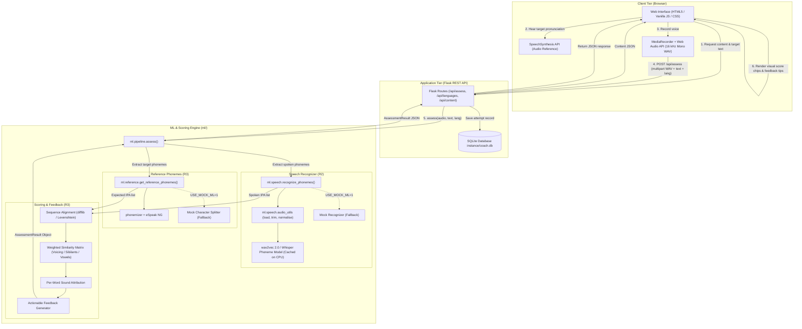

# System Architecture: Language Coach

This document details the architectural components, data pipelines, and interaction flows for the **Language Coach** multilingual pronunciation assessment system.

---

## 1. End-to-End System Pipeline



---

## 2. Sequence Diagram: Single Practice Attempt

```mermaid
sequenceDiagram
    autonumber
    actor Learner as User
    participant Browser as Client UI (Browser)
    participant WebAudio as Web Audio API
    participant Flask as Flask Server (app/routes)
    participant Pipeline as ML Pipeline (ml.pipeline)
    participant Ref as Reference Engine (ml.reference)
    participant ASR as Speech Recognizer (ml.speech)
    participant Scorer as Scorer Engine (ml.scoring)
    participant DB as SQLite DB (app/db)

    Learner->>Browser: Selects Language & Target Text (e.g., "ship")
    Browser->>Learner: Plays Reference Pronunciation via Web Speech Synthesis
    Learner->>Browser: Clicks "Record" and speaks into microphone
    Learner->>Browser: Clicks "Stop Recording"
    Browser->>WebAudio: Decodes PCM & Encodes into 16 kHz Mono WAV
    Browser->>Flask: POST /api/assess (WAV file, text="ship", language="english")
    
    Flask->>Pipeline: assess(temp_wav_path, "ship", "english")
    
    par Extract Expected Phonemes
        Pipeline->>Ref: get_reference_phonemes("ship", "english")
        Ref-->>Pipeline: Expected IPA: ['ʃ', 'ɪ', 'p']
    and Extract Spoken Phonemes
        Pipeline->>ASR: recognize_phonemes(temp_wav_path, "english")
        ASR-->>Pipeline: Spoken IPA: ['s', 'ɪ', 'p']
    end

    Pipeline->>Scorer: score_words(["ship"], [['ʃ', 'ɪ', 'p']], ['s', 'ɪ', 'p'])
    Note over Scorer: Aligns /ʃ/ with /s/ -> Phonetically similar (weight 0.5)<br/>Aligns /ɪ/ with /ɪ/ -> Match (1.0)<br/>Aligns /p/ with /p/ -> Match (1.0)<br/>Word score = 83.3%
    Scorer-->>Pipeline: WordResult + Feedback: "You said /s/ in 'ship'; expected /ʃ/."
    
    Pipeline-->>Flask: AssessmentResult(overall_score=83.3, words=[...], feedback=[...])
    Flask->>DB: save_attempt(AssessmentResult)
    DB-->>Flask: Confirmation
    Flask-->>Browser: JSON response (200 OK)
    
    Browser->>Learner: Displays overall score (83%), color-coded sound chips, and advice
```
